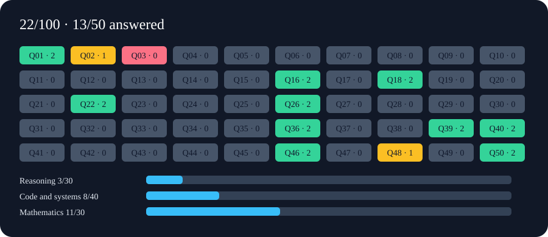

# Deterministic Model Test 50 — v2

**How does your model score?** 50 questions. 100 exact checks. No AI judge.

[**Open the report demo**](https://prism77proton.github.io/Model-Test-v2/) ·
[**Test your model**](#run-against-your-model) ·
[**Paste answers**](https://github.com/Prism77Proton/Model-Test-v2/issues/new?template=model-test.yml)

[](https://prism77proton.github.io/Model-Test-v2/)

*Illustrative partial submission, not a measured model score. The full report
shows every check, the expected value, and what the model returned.*

Paste model answers into a GitHub issue. GitHub Actions generates exact scores,
an offline HTML report with a 50-question graphic, field-by-field differences,
CSV, JSON, and a Markdown summary. No AI judge, paid API, or external Python packages.

## Run against your model

Start your inference application's HTTP service, then run:

```bash
python run_models.py
```

Enter its URL, choose a model from the server's available list, and the runner
loads that model through the server's API. It then sends **one question per fresh
request**, sequentially, and saves answers, exposed reasoning, token usage,
timing, errors and an HTML report after every question. It does not launch a
server process or use SSH. The server application must already be reachable.

- **LM Studio:** native model listing and explicit `/api/v1/models/load`.
- **Unsloth Studio:** available `/v1/models` plus explicit `/api/inference/load`.
- **Other OpenAI-compatible servers:** `/v1/models` and `/v1/chat/completions`;
  loading is handled by that server, because OpenAI compatibility has no standard
  model-loading API. A standalone llama-server must already serve its model.

Examples (Python 3.12+, standard library only):

```bash
python run_models.py --url http://localhost:1234
python run_models.py --url http://localhost:1234 --url http://192.168.0.97:8888
python run_models.py --url http://192.168.0.97:8888 --key-file /path/to/private/api-key --list
python run_models.py --url http://localhost:1234 --model EXACT_ID --only Q01 --out runs/pilot
python run_models.py --url http://localhost:1234 --model EXACT_ID --out runs/full
python run_models.py --url http://localhost:1234 --model EXACT_ID --out runs/full --resume
```

The first two commands offer interactive selection. `--list` is read-only and
never loads or generates. For authentication use `--key-file`, the `MODEL_API_KEY`
environment variable (or `--key-env NAME`), or the hidden interactive prompt after
an authentication failure. Keys are not stored in the run manifest or sent to GitHub.
Each URL uses its own invocation/key; a chosen server's key is not tried against
the other URLs. Redirects are refused and environment proxies are bypassed.

Defaults: context 32768, maximum output 8192 tokens, temperature 0, load timeout
1800 seconds, question timeout 10800 seconds. Adjust with `--context`, `--max-tokens`,
`--temperature`, `--load-timeout`, `--timeout`. Temperature 0 does not promise
bit-for-bit reproducible generation; **grading** is deterministic.

Backend-specific settings can be supplied with `--load-options private-load.json`
and `--chat-options private-chat.json`. These are JSON objects; load options may
include hardware settings supported by your server, and chat options may include
thinking controls. The runner refuses overrides of question isolation, model
identity, or transport settings. It does not change CPU limits or system services.
Loading follows the chosen server's memory/eviction policy and may replace an
existing resident model. Large models can take many minutes to load.

Each run folder contains `Qnn.json`, raw SSE events, answer/reasoning text,
`performance.json`, `recording-status.json`, a GitHub-ready `answers.jsonl`, and
`report/report.html`. Only the question prompt is sent; never the answer key.
Resume requires identical server, model, settings, suite and question hashes.
Completed questions are not sent again. Failed attempts are archived before retry.
Two runners cannot use the same output folder simultaneously.

For a completed request with malformed output or a token-limit truncation, the
recorder exports the known requested question with two null answer fields: exactly
zero credit. It never guesses or repairs an answer; the raw response, failure
reason and its hash are preserved. A transport failure stops the run and remains
missing until resumed. `recording-status.json` distinguishes these cases. Manual
issue submissions must still obey the JSONL envelope grammar.

Ctrl+C saves partial output and stops this client. It does **not** guarantee the
server cancels inference or unloads the model. Use the server's Stop/Unload control
when needed. The runner leaves the model resident after a completed test.

Paste `runs/full/answers.jsonl` into the GitHub issue form to share the report.
Keep full run folders private unless you intend to publish their contents.

## Report on the repository front page

The README embeds the example graphic and links the full report demo above.
To make that demo live, set **Settings → Pages → Build and deployment → Source →
GitHub Actions**, then run **Actions → Publish report demo**. Later changes to the
demo inputs rebuild it automatically on `main`. The Pages workflow publishes
only the illustrative demo, never files from `runs/` or issue submissions.
See [GitHub Pages setup](https://docs.github.com/en/pages/getting-started-with-github-pages/using-custom-workflows-with-github-pages).

Native model APIs: [LM Studio listing](https://lmstudio.ai/docs/developer/rest/list),
[LM Studio loading](https://lmstudio.ai/docs/developer/rest/load), and
[Unsloth API source](https://github.com/unslothai/unsloth/blob/main/studio/backend/routes/inference.py).

## Put it on GitHub

1. Create a repository with Issues and Actions enabled.
2. Commit this folder's **contents at the repository root**, including `.github`.
   The workflow and issue form must be on the default branch. A ZIP alone in the
   repository does not install the workflow. If uploading through a browser hides
   `.github`, create its files using GitHub's Add file editor with their full paths.
3. Go to **Issues → New issue → Model test**.
4. Enter the model name and paste the JSONL answers. Submit the issue.
5. A report comment links the download. Unzip it and open `report.html`.
   The Actions run also displays the score summary. Editing the issue regenerates
   the report and posts another comment with the new snapshot's report.

No custom secrets or model hosting are required. The workflow uses GitHub's
automatically supplied token to comment in this repository. Repository/organization
policies must allow the listed actions and the job's `issues: write` permission.
The workflow uses standard Ubuntu runners; no connection to your R820 is needed.
It processes issue event snapshots, so each report records the exact submitted text
hash rather than silently changing an older report when an issue is edited.

GitHub documents [issue form behavior](https://docs.github.com/en/communities/using-templates-to-encourage-useful-issues-and-pull-requests/syntax-for-issue-forms),
[issue-triggered workflows](https://docs.github.com/en/actions/reference/workflows-and-actions/events-that-trigger-workflows#issues),
and [artifact downloads](https://docs.github.com/en/actions/managing-workflow-runs/downloading-workflow-artifacts).
Standard hosted runners in public repositories are free; private repositories use
the plan's included compute allowance. Artifact storage has separate allowances.
See [GitHub Actions billing](https://docs.github.com/en/billing/concepts/product-billing/github-actions).
This workflow retains small report artifacts for seven days. Download reports you
want to keep. Issue comments preserve the numeric summary after artifacts expire.
Downloading artifacts requires GitHub sign-in and repository read access.

## Run the model one question at a time

Give the model **only** `questions/Q01.txt`, then Q02.txt, etc., in fresh contexts.
Each file includes instructions and one question, without an answer key. Do not
give the tested model this full repository: it contains the oracle and grading code.
Concatenate the returned one-line JSON records into one text file or the issue form.
A partial run of even one question is supported. As more answers arrive, append
them to the same issue's Answers block and save the edit. Retain the form headings.

The format is one record per nonblank line:

```json
{"id":"Qnn","answer":{"first_field":"value","second_field":"value"}}
```

That is a format illustration, not a valid question/answer. Actual field names and
types appear in each question. Optional top-level `rationale` is an unscored string.
No Markdown or surrounding prose in a model response. The issue form supplies the
outer text fence automatically; paste the records without adding another fence.
The local CLI also accepts one outer `text`, `json`, or `jsonl` fence.

Use JSON integer numbers, exact reduced rational strings `n/d`, Boolean literals,
and arrays ordered as specified. Object key order does not matter. Integer-looking
decimals such as `1.0`, exponent notation, NaN, duplicate JSON keys, duplicate or
unknown question IDs, and missing/extra answer fields invalidate the submission.
A Boolean in place of an integer is a wrong typed value, not a numeric match.
Oversized (>1 MB), invalid UTF-8, and excessively nested input are rejected.

There are **100 independent field checks**, two per question. Each complete field
earns exactly 1 or 0 points; an array field must match in its entirety. Missing
questions are gray and score zero toward the full 100. The report separately shows
the score over attempted fields. Format-invalid submissions receive **no score**.
Every result includes hashes of the suite+key and submitted text. Same suite and
answers always produce the same grades; model label and GitHub timing do not affect them.

## What changed from the original test

All 50 original topics have revised tasks with finite, specified output contracts.
For example, proof obligations became exact extrema, counterexample certificates,
trace predictions, or fixed-case decisions. Open programming implementations became
code and systems analysis over fixed fixtures. No submitted code is executed.

This is a **different test**: it measures exact output correctness, structured
instruction following, and the supplied certificates. It does not establish that
an arbitrary proof is valid, an unrestricted program is correct, or a model can
implement the complete original specification. No human-review queue or semantic
grader is used. Scores are not comparable to v1 and are not calibrated percentiles.
Deterministic scoring does not establish that an answer key is infallible. Oracle
tests independently enumerate finite fixtures and check exact arithmetic; changes
to questions/keys require a version change and review. Publishing the oracle makes
this an open practice test, not a contamination-resistant hidden benchmark.

## Local use

Python 3.12 or later, standard library only:

```bash
python -m unittest discover -s tests -v
python grade.py --answers answers.jsonl --model "Model and settings" --out report
```

`examples/demo-answers.jsonl` is a deliberately mixed partial submission. The
included `example-report/report.html` is its generated preview, not a real model result.
Exit 0 means valid submission (even a score of zero); exit 2 means invalid format.
Use `results.json` to decide score thresholds separately.

`build_suite.py` regenerates the public questions and oracle. It is a maintenance
tool, not run against submissions. Keep the two generated JSON files versioned.
`test.yml` checks the grader on pushes and pull requests with read-only permissions;
`grade.yml` checks it again before processing issue data. Submitted code and shell
fragments remain inert strings. HTML output escapes all submitted values and uses
no scripts or external resources. Full reports contain answer-key values, so they
are for reviewing a completed attempt, not feeding back into an ongoing closed-book attempt.

No license has been selected; choose one before offering explicit reuse terms.
